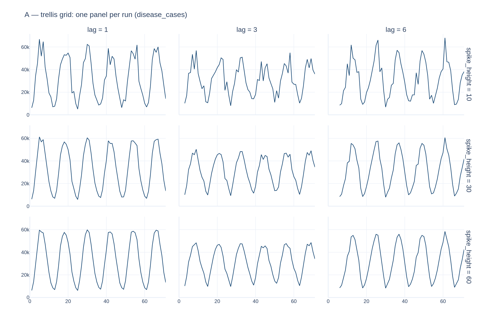
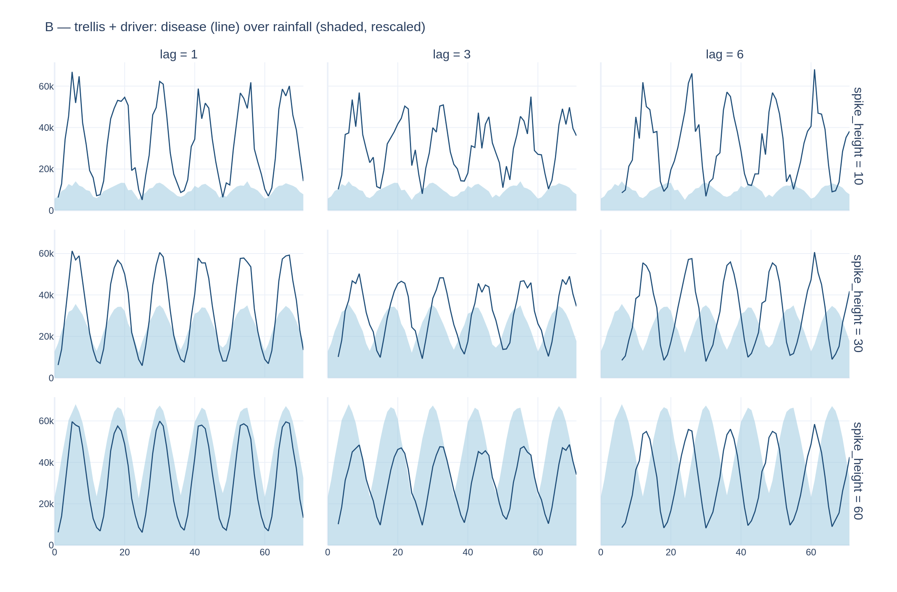
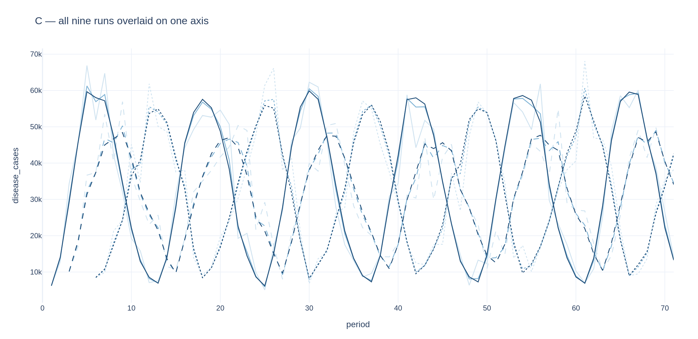
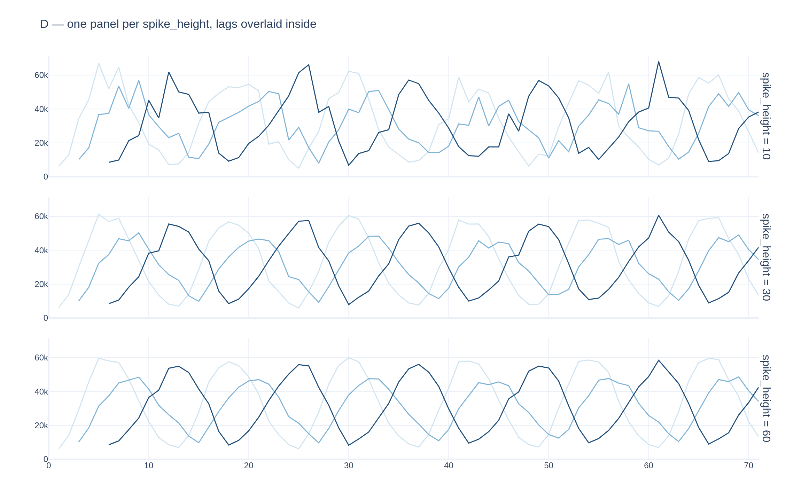
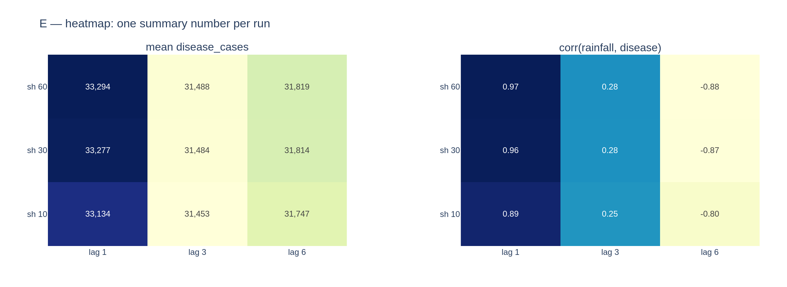
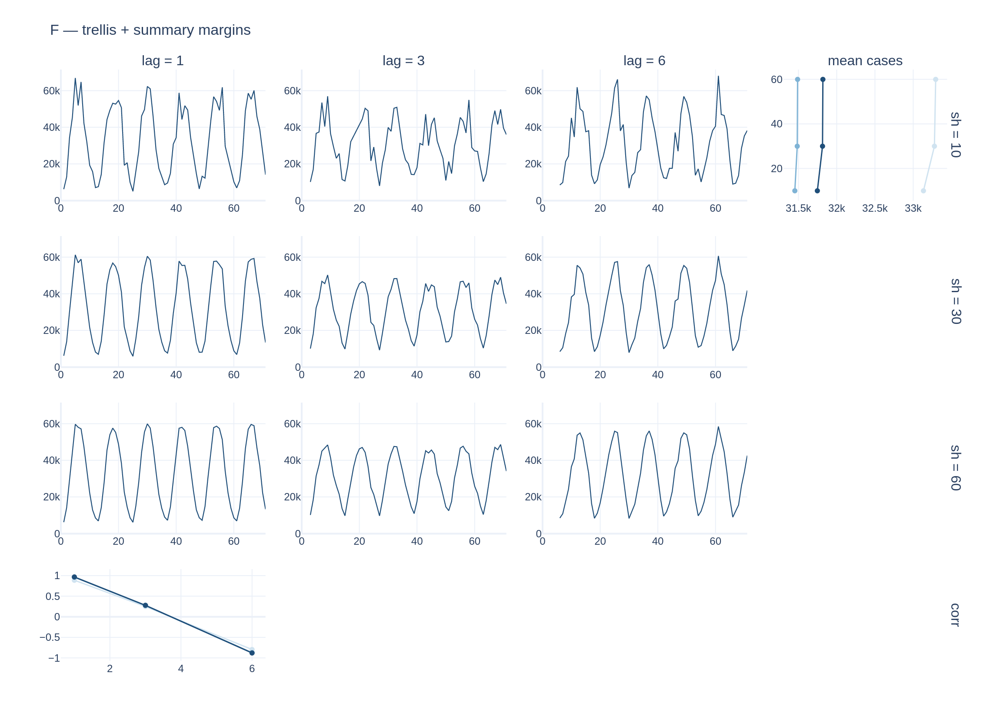

# Sweep plot layouts — six options, real data

Throwaway spike for the "panel med ni ting" ask from the 2026-11-03 meeting.
Nothing here is wired into `dsl`; it exists so the layouts can be compared
before one is built.

## What is plotted

A real 3×3 sweep, generated by this repo:

```yaml
preset: climate
n_total: 72                 # six years, monthly
series:
  - name: rainfall
    params:
      spike_height: { sweep: [10, 30, 60] }
  - name: disease_cases
    depends_on:
      - series: rainfall
        lag: { sweep: [1, 3, 6] }
```

Nine datasets, 72 periods each, location `north`. Regenerate with:

```bash
dsl run tools/sweep_plot_spike/scenario.yaml -o tools/sweep_plot_spike/out
python3 tools/sweep_plot_spike/make_plots.py
```

**What to look for:** `spike_height` controls how strongly rainfall dominates
the disease signal (higher = cleaner yearly wave, lower = noisier), and `lag`
shifts the disease peak later relative to rainfall. A good layout makes both
readable at once.

---

## A — trellis grid, disease only



**TL;DR:** nine panels in a 3×3 grid, one per run, each showing disease over
time. Row and column labelled once at the edge.

Reads cleanly and the `spike_height` effect is obvious — the top row (10) is
visibly noisy, the bottom row (60) is a clean repeating wave. The **lag** effect
is nearly invisible, because without rainfall to compare against, a shifted
curve just looks like a curve.

*Good for: the shape of the outcome. Bad at: anything about timing.*

---

## B — trellis grid + the driver behind it



**TL;DR:** the same grid, with rainfall shaded underneath each panel (rescaled
to share the axis — the shape is the point, not its units).

This is the only layout where **both** swept parameters are visible. Going down
a column, the shading grows and the disease line gets smoother. Going across the
bottom row, the disease peaks visibly slide to the right of the rainfall humps —
that is the planted lag, drawn.

The cost: twice the ink, and the rescaled driver has no y-axis of its own, so
you can read its *shape* but not its values.

*Good for: seeing the planted relationship itself. Bad at: reading driver values.*

---

## C — everything overlaid on one axis



**TL;DR:** all nine runs as nine lines on a single chart.

Unreadable, which is the useful result. Nine seasonal curves at different
offsets cross constantly, and no colour scheme separates two parameters on one
axis. (The legend also failed to render, which rather makes the point.)

*Good for: nothing at nine runs. Might work at three.*

---

## D — one panel per spike_height, lags overlaid inside



**TL;DR:** three panels instead of nine; inside each, the three lags are drawn
on top of each other.

A middle ground, and the lag shift is clearer than in A — you can see three
offset copies of the same wave. But with three overlaid lines per panel it is
already busy, and which line is which lag is not obvious without a legend
(darkest is `lag 6`, which reads backwards).

*Good for: comparing one parameter. Scales badly past ~3 values.*

---

## E — heatmap, one number per run



**TL;DR:** no time axis at all. Each run collapses to a single summary number,
shown as a coloured grid.

The most interesting result of the whole spike. **Mean cases barely moves**
(33.3k → 31.5k across every combination), while **correlation with rainfall
swings hard**: `0.97 → 0.28 → −0.88` as lag goes 1 → 3 → 6, at every spike
height. With a six-month lag on a twelve-month cycle the disease peaks in
rainfall's trough, so the correlation inverts.

So: the right summary statistic shows the planted relationship immediately, and
the wrong one shows nothing. Worth knowing before building anything.

*Note:* rows run bottom-up (`sh 10` at the bottom), which needs fixing if this
layout is used.

*Good for: spotting the pattern across many runs at a glance, and scales to far
more than nine. Bad at: it throws away the time series entirely.*

---

## F — trellis with summary margins



**TL;DR:** layout A, plus a right-hand column and a bottom row showing how the
summary statistic moves along each axis.

The bottom-left margin is the best single panel here — a clean straight line
from +1 to −0.9 showing correlation collapsing as lag grows. Combining the
detail and the summary in one figure is attractive in principle.

In practice this draft is rough: the margins only occupy one cell each rather
than spanning the full edge, and each panel kept its own axis ticks, so it is
cluttered. Fixable, but it is the most layout code of the six.

*Good for: one figure that answers both "what happened" and "what is the trend".
Bad at: it needs real work to look right.*

---

## Where I would start

**B** as the default (`--plot` on a swept run), because it is the only one that
shows both swept parameters and the planted relationship at once.

**E** as a second output, because it scales to sweeps much bigger than 3×3 and
— per the correlation result above — can surface the relationship far faster
than reading nine time series.

**C** is a dead end. **D** is a worse B. **F** is B+E in one figure and could
come later if the two separately prove annoying.

Open questions if we build this: which series goes in the panels when a scenario
has several; what to do with more than two swept parameters (facet on two, and
then what?); and what happens at, say, 100 runs, where any per-run panel stops
working and only E survives.
